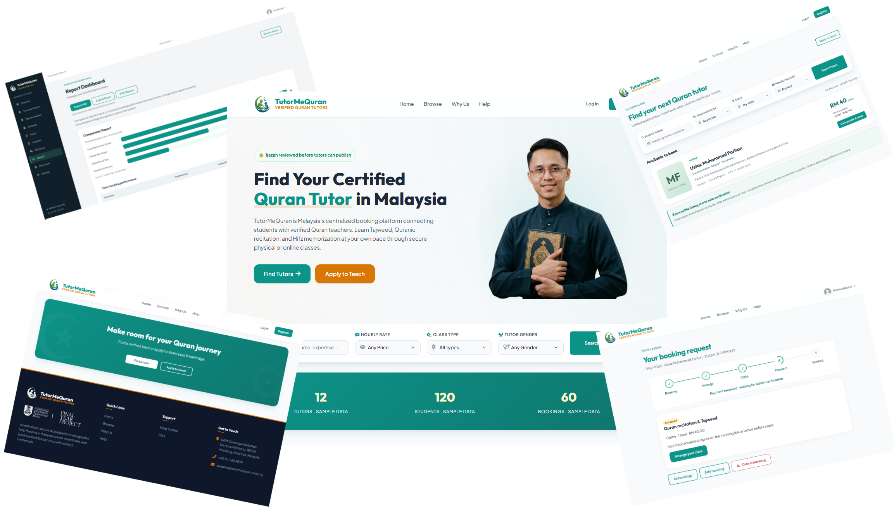

<h1 align="center">TutorMeQuran</h1>

<p align="center">
  
</p>

<p align="center">
  A Quran tutor booking platform for learners in Malaysia.<br>
  Discover qualified tutors, arrange online or physical lessons, and follow bookings through class completion and payment verification.
</p>

<p align="center">
  
  
  
  
  
</p>

----



## About the project

TutorMeQuran is a CSP600 academic project at Universiti Teknologi MARA (UiTM). It brings tutor discovery, certificate review, lesson booking and payment tracking into one interface for students, tutors and administrators.

This repository currently contains the **static HTML, CSS and JavaScript prototype**. Selected interactions work locally in the browser; PHP and database integration are planned. Displayed accounts, bookings and reports use sample data.

## Features

| Area | Included screens and interactions |
| --- | --- |
| Students | Tutor search, registration, profile editing, pending and past bookings, invoices, receipt upload and feedback |
| Tutors | Application and certificate status, profile and visibility settings, availability, booking acceptance/rejection, DuitNow QR management and payment acknowledgement |
| Administrators | Tutor certificate review, student and tutor management, booking management, payment review and FAQ management |
| Reports | Dashboard with comparison and composition reports |
| Support | Help Centre, support request forms, contact options and FAQs |
| Usability | Shared progress indicators, grouped account menus, destructive-action confirmations, keyboard navigation and reduced-motion support |

## Booking journey

1. **Request a lesson** — the student chooses a tutor and an available slot.
2. **Accept and arrange** — the tutor accepts or rejects the request; participants agree on meeting details.
3. **Attend the class** — lessons take place online through an external service or at an agreed physical venue.
4. **Confirm completion** — the student and tutor each confirm that the lesson took place.
5. **Pay with DuitNow** — the student uses the tutor's QR and uploads the transfer receipt.
6. **Confirm and verify** — the tutor acknowledges the funds received, then admin reviews the payment to close the booking.

Tutor acknowledgement and admin verification are separate stages. DuitNow transfers take place outside the website; the prototype does not process money or verify bank transactions automatically.

## Run locally

Clone the repository and serve it with Python 3:

```bash
git clone https://github.com/KuDanial/tutormequran-web-application.git
cd tutormequran-web-application
python -m http.server 8000 --bind 127.0.0.1
```

Open [localhost:8000](http://localhost:8000). No build step or package installation is required. An editor's local HTTP server also works.

Use the same browser tab when checking related student and tutor booking screens: selected prototype actions share `sessionStorage` in that tab. They do not sync between users, tabs or devices. A local HTTP server provides more consistent browser storage behaviour than opening files directly.

## Useful starting pages

| Page | File |
| --- | --- |
| Home | [index.html](index.html) |
| Browse tutors | [tutors.html](tutors.html) |
| Registration | [register.html](register.html) |
| Student dashboard | [student/student-dashboard.html](student/student-dashboard.html) |
| Tutor application status | [tutor/tutor-dashboard.html](tutor/tutor-dashboard.html) |
| Verified tutor dashboard | [tutor/tutor-dashboard-verified.html](tutor/tutor-dashboard-verified.html) |
| Admin dashboard | [admin/admin-dashboard.html](admin/admin-dashboard.html) |
| Reports | [report/report-dashboard.html](report/report-dashboard.html) |

## Repository structure

```text
tutormequran-web-application/
├── assets/
│   ├── css/          Shared styles
│   ├── img/          Logos, screenshots and other images
│   └── js/           Interface interactions and local workflow state
├── student/          Student pages
├── tutor/            Tutor pages
├── admin/            Administration pages
├── report/           Reporting dashboard
├── docs/             Workflow and implementation notes
├── index.html        Public landing page
├── register.html     Student registration and tutor application
└── INTERFACE-GUIDE.md
```

## Implementation status

The interface includes local booking decisions, class-completion confirmations, receipt handling and tutor payment acknowledgement. Chat and support requests do not send messages to another user or a server. Profile saves and other static controls still require backend implementation.

The PHP phase will need authentication, role and record ownership checks, database persistence, booking-slot protection, server-side validation, file storage, messaging and admin verification. Client-side confirmations and browser storage are interface behaviour, not access controls.

Extra pages preserve the earlier tutor setup and publishing flow for reference. The main registration and application dashboard use **Apply → Admin verification**, with teaching details and visibility managed through Edit Profile.

## Project documentation

- [Interface guide and page map](INTERFACE-GUIDE.md)
- [Tutor booking and payment workflow](docs/tutor-workflow.md)
- [Booking progress, action confirmations and PHP migration](docs/booking-progress-and-actions.md)
- [Student navigation and proposal scope](docs/student-navigation-scope.md)

## Author

**Tengku Ahmad Danial Tengku Noor Ashraf** · [@KuDanial](https://github.com/KuDanial)  
Universiti Teknologi MARA · CSP600 academic project
